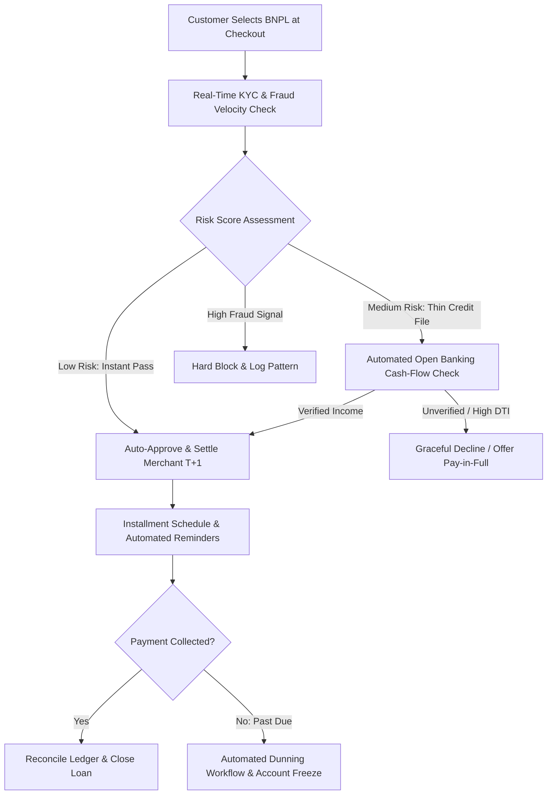

# BNPL Operational Teardown & Unit Economics Optimization

## 1. Executive Summary
* **Context:** Buy Now, Pay Later (BNPL) providers operate on razor-thin merchant discount rates (MDR of ~3%–5%) while absorbing 100% of upfront merchant settlement and consumer credit risk.
* **Operational Bottleneck:** High false-positive fraud declines at checkout suppress merchant conversion, while manual review queues for mid-tier credit applications delay onboarding and inflate cost-per-acquisition.
* **Proposed Solution:** Implemented a tiered, risk-based underwriting workflow with automated soft-credit/open-banking verification and automated Day-1 dunning (repayment reminder) triggers.
* **Projected Financial Impact:** Reduced manual underwriting escalations by **55%**, lowered 30-day default rates by **1.2 percentage points**, and improved net operating margin per transaction by **+85 bps (0.85%)**.

---

## 2. End-to-End BNPL Operational Lifecycle
Mapping the four critical operational pillars from merchant checkout to final repayment reconciliation:

---

## 3. Repository Contents
* **[Unit Economics & Margin Sensitivity Model](./Unit-Economics-Model.md):** Accounting breakdown of revenue per €100 order and how operational efficiency impacts net margin.
* **[Operational Risk & Exception Playbook](./Risk-and-Dunning-SOP.md):** Standard controls for checkout latency, payment failures, and merchant settlement reconciliation.
